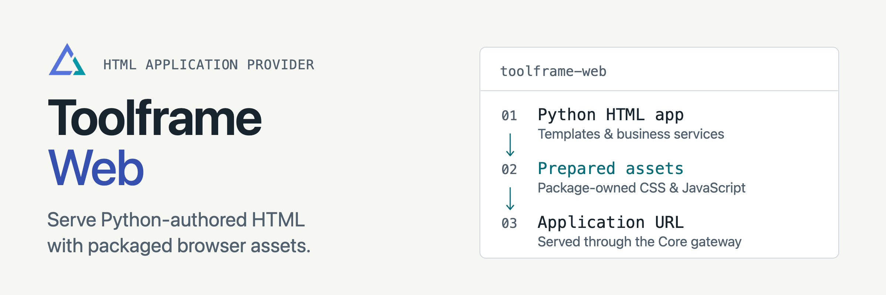

<p align="center">
<picture>
  <source media="(prefers-color-scheme: dark)" srcset="docs/assets/readme-banner-dark.png">
  <source media="(prefers-color-scheme: light)" srcset="docs/assets/readme-banner-light.png">
  
</picture>
</p>

# Toolframe Web

[](https://github.com/toolframe/toolframe-web/actions/workflows/ci.yml?query=branch%3Amain)

Build Python-authored HTML apps on Toolframe’s public URL.
Each app owns its templates and browser assets, and calls services with the visitor’s permissions.

## Quick start

Use Python 3.14+, Core 0.8+ and SDK 0.4.1+. With the Toolframe CLI installed,
generate the bundled Notes app:

```sh
toolframe --home APP plugin new notes   --from pypi:toolframe-web==0.1.1 --template toolframe-web/notes
toolframe --home APP web prepare APP/plugins/notes
```

This creates source and prepares its wheel. Follow [Run Web Notes](docs/quickstart.md)
to initialize the app, install SQL/Web providers and mount Notes at `/`.
Generating a template does not enable providers or change application composition.

**Support:** finite HTTP handlers, forms, JSON and sealed static assets. General
WebSockets, SSE, streaming responses and arbitrary ASGI mounts are outside Web v1.
Apps are trusted code sharing the application's origin. Installed wheels serve
local assets without Node, npm or CDN requests.

## Guides

| I want to… | Start here |
| --- | --- |
| Run the Notes starter | [Quick start](docs/quickstart.md) |
| Write routes, forms and templates | [Authoring](docs/authoring.md) |
| Prepare browser libraries and styles | [Assets](docs/assets.md) |
| Understand permissions and limits | [Access](docs/access.md) |
| Contribute or run checks | [Contributing](CONTRIBUTING.md) · [Verification](docs/ci.md) |

[Releases](https://github.com/toolframe/toolframe-web/releases)

## License

Provider: [Apache 2.0](LICENSE), with [NOTICE](NOTICE).
The bundled Notes template and generated projects use MIT.
